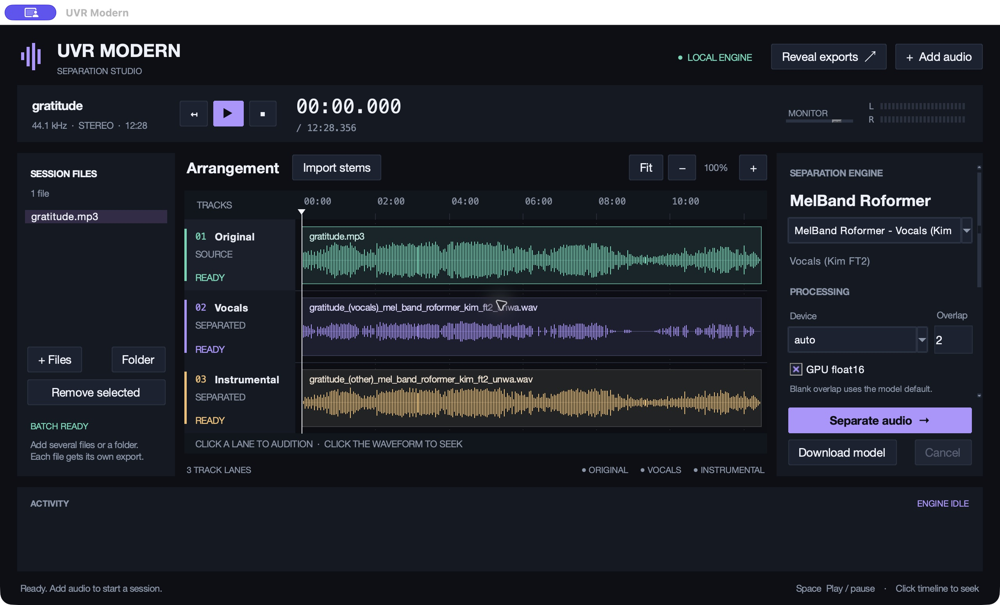

UVR Modern 1.1.0 brings a DAW-style audio separation workspace to Apple Silicon Macs.



### Highlights

- Dark studio layout with real waveform lanes, timeline zoom, and a model/export inspector.
- Playback, pause, seek, preview volume, and stereo peak meters.
- Import existing stems and switch between the original and stems at the same timeline position.
- Eight modern model presets, including BS-Roformer and Mel-Band Roformer.
- WAV, FLAC, and MP3 exports, batch processing, Apple MPS acceleration, and optional GPU float16.
- Self-contained Mac app with Python, Tcl/Tk, FFmpeg, and the separation runtime included.

### Download and install

Requires **Apple Silicon and macOS 14 or newer**. Download `UVR-Modern-1.1.0-arm64.dmg`, open it, and drag **UVR Modern.app** into **Applications**.

Model weights download separately on first use. Audio separation runs locally.

To verify the download, place the DMG and `SHA256SUMS.txt` in the same folder, open Terminal in that folder, and run:

```sh
shasum -a 256 -c SHA256SUMS.txt
```

### Preview status

This build is **ad-hoc signed and is not Apple-notarized**. macOS may block its first launch; only allow the app if you trust this release and its source. Developer ID signing and notarization are still needed for a normal trusted distribution.

Only one track plays at a time. Saving/reopening studio projects and simultaneous multitrack mixing are not implemented. This release contains an Apple Silicon build; Intel Macs are not supported by this disk image.

### Verification

- 62 regression tests passed.
- App signature verification and DMG integrity checks passed.
- Bundled application sources match the release checkout.
- Manual checks covered real audio playback, stem audition, and Apple MPS separation, including a full 12-minute recording.

This fork builds on [Ultimate Vocal Remover GUI](https://github.com/Anjok07/ultimatevocalremovergui) and [audio-separator](https://github.com/nomadkaraoke/python-audio-separator).
